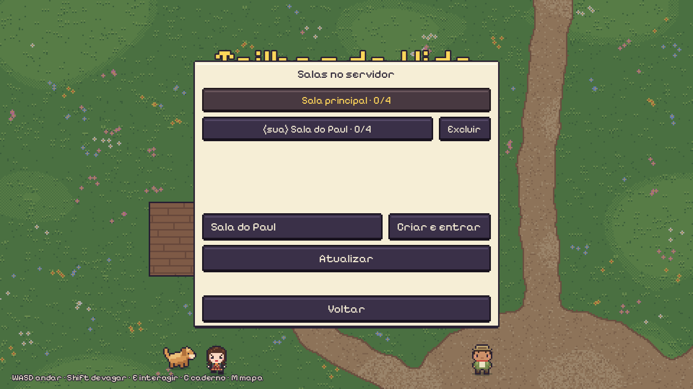
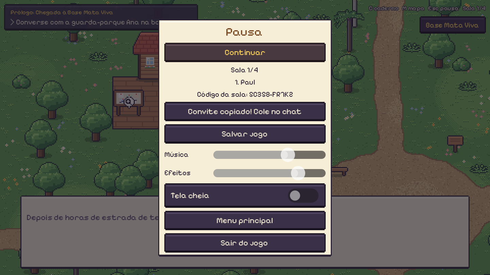

# Trilhas da Vida — instalar

RPG 2D aconchegante de exploração ecológica na Mata Atlântica, para jogar sozinho ou com até 3 amigos.
Este repositório tem só o instalador e o jogo pronto (Windows). O código-fonte é privado.


## Instalar

Abra o **PowerShell** e cole:

```powershell
irm https://raw.githubusercontent.com/kevrauzika/TrilhasDaVida-download/HEAD/install.ps1 | iex
```

O jogo é instalado em `%LOCALAPPDATA%\TrilhasDaVida` e o atalho **Trilhas da Vida** aparece na Área de Trabalho.
Rodar o comando de novo atualiza o jogo; o progresso salvo é mantido.

Desinstalar:

```powershell
irm https://raw.githubusercontent.com/kevrauzika/TrilhasDaVida-download/HEAD/desinstalar.ps1 | iex
```

## Jogar com amigos (até 4)

1. Menu → **Jogar com amigos** → **Salas no servidor**.
2. Clique numa sala para entrar, ou dê um nome e clique em **Criar e entrar**. Cada sala tem o próprio progresso, salvo no servidor. As salas que você criou aparecem como "(sua)" e têm o botão **Excluir**.
3. Dentro da sala, **Esc** mostra o código da sala e o botão **Copiar convite**: uma mensagem pronta com o comando de instalar, o código e como entrar. É só colar no chat. Quem recebe entra por **Jogar com amigos** → digite o código → **Entrar na sala**.





Sem servidor, alguém pode clicar em **Hospedar no meu PC** (na primeira vez, o Windows pergunta sobre o firewall: clique em **Permitir acesso**). Pela internet, o jeito mais fácil é todos usarem o [Tailscale](https://tailscale.com/download) e o código "Tailscale"; no mesmo Wi-Fi, o código "Mesma rede".

### Servidor do grupo (VPS)

Numa VPS Debian/Ubuntu (x86_64), rode:

```bash
curl -fsSL https://raw.githubusercontent.com/kevrauzika/TrilhasDaVida-download/HEAD/instalar-servidor.sh | sudo bash
```

Isso instala o **salão** (porta UDP 7777), que cria e apaga as salas pedidas pelo jogo (portas UDP 7801–7808). Libere essas portas também no firewall do painel do provedor. Cada sala usa ~90 MB de RAM; o limite é 8 salas, 2 por pessoa. Rodar o comando de novo atualiza o servidor sem perder salas nem progresso. Logs: `journalctl -u trilhas -f`.

## Controles

WASD ou setas para andar · Shift devagar · E interagir · C caderno · M mapa · F lanterna · Esc pausa


