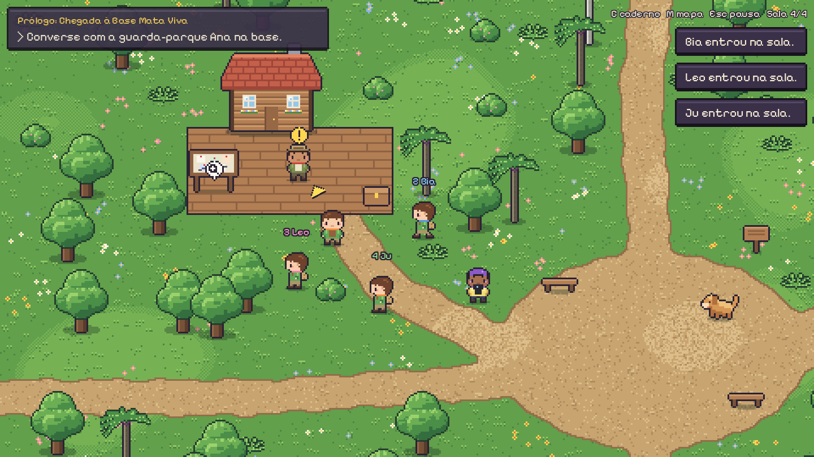
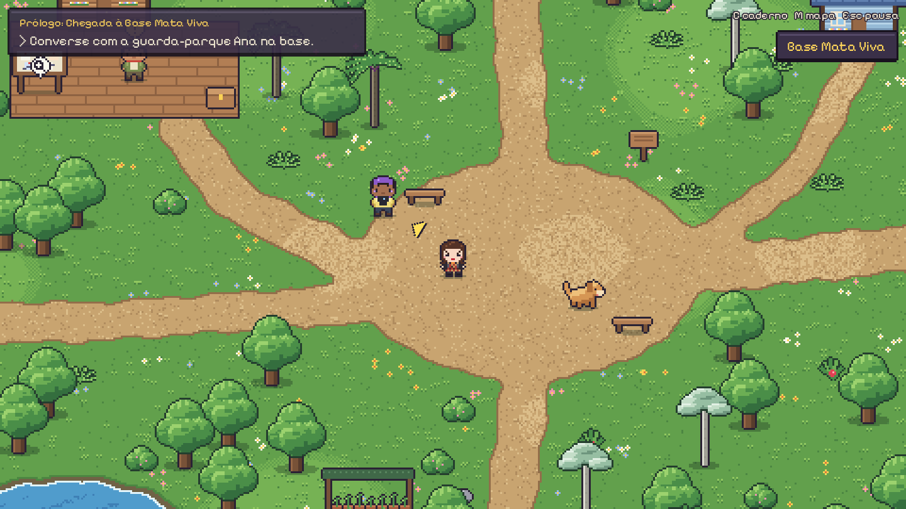

# Trilhas da Vida — instalar

RPG 2D aconchegante de exploração ecológica na Mata Atlântica, para jogar sozinho ou com até 3 amigos.
Este repositório tem só o instalador e o jogo pronto (Windows). O código-fonte é privado.



## Instalar

Abra o **PowerShell** e cole:

```powershell
irm https://raw.githubusercontent.com/kevrauzika/TrilhasDaVida-download/HEAD/install.ps1 | iex
```

O jogo é instalado em `%LOCALAPPDATA%\TrilhasDaVida` e o atalho **Trilhas da Vida** aparece na Área de Trabalho.
Rodar o comando de novo atualiza o jogo; o progresso salvo é mantido.

Desinstalar:

```powershell
irm https://raw.githubusercontent.com/kevrauzika/TrilhasDaVida-download/HEAD/desinstalar.ps1 | iex
```

## Jogar com amigos (até 4)

1. Quem hospeda: menu → **Jogar com amigos** → **Hospedar sala**. Na primeira vez, o Windows pergunta sobre o firewall: clique em **Permitir acesso**.
2. O código da sala aparece na pausa (**Esc**). Mande para os amigos.
3. Quem entra: menu → **Jogar com amigos** → digite o código → **Entrar na sala**.

Pela internet, o jeito mais fácil é todos usarem o [Tailscale](https://tailscale.com/download) na mesma rede e usar o código "Tailscale". No mesmo Wi-Fi, use o código "Mesma rede".

## Controles

WASD ou setas para andar · Shift devagar · E interagir · C caderno · M mapa · F lanterna · Esc pausa


